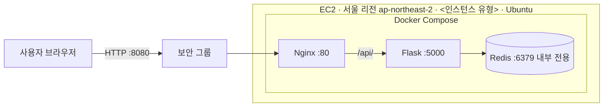

# 좌석 티켓 예매 서비스

경기·공연 예매가 열리는 순간 접속이 몰려도 **같은 좌석이 중복 예매되지 않도록** 임시 확보(5분)와 결제 확정으로 처리하는 웹서비스입니다.

- 배포 주소: http://<퍼블릭IP>:8080 (검사 완료까지 유지)
- 저장소: https://github.com/Aa26178787/ticket_booking
- 작업 버전: 901ce97

## 1. 서비스 소개

### 대상 사용자와 핵심 기능

| # | 기능 | 사용자 입력 | 결과 |
|---|---|---|---|
| 1 | 경기 선택·좌석 조회 | 경기 선택 | 좌석 40석(A1~E8)과 상태 표시 |
| 2 | 좌석 선택(임시 확보) | 좌석 클릭 + 닉네임 | 5분간 좌석 잠금, 남은 시간 표시 |
| 3 | 결제 확정·취소 | 결제 완료 / 취소 버튼 | 예매 완료 또는 좌석 해제 |

좌석 상태는 예매 가능 / 임시 확보 / 예매 완료 3가지이며, 화면은 3초마다 상태를 갱신해 다른 사용자의 선택이 자동으로 반영됩니다.

### 접속이 몰리는 지점

예매 오픈 직후 여러 사용자가 같은 좌석을 동시에 선택합니다. 좌석 선택은 Redis의 `SET NX EX`로 처리해, 동시에 눌러도 **한 명만 성공**하고 나머지는 409 응답을 받습니다. 임시 확보는 TTL(기본 5분)이 지나면 자동으로 풀립니다.

### API

| 메서드 | 경로 | 설명 |
|---|---|---|
| GET | `/api/health` | 상태 확인 |
| GET | `/api/events` | 경기 목록 |
| GET | `/api/events/<id>/seats` | 좌석 상태 조회 |
| POST | `/api/events/<id>/seats/<seat>/hold` | 좌석 임시 확보 |
| POST | `/api/events/<id>/seats/<seat>/confirm` | 결제 확정 |
| DELETE | `/api/events/<id>/seats/<seat>/hold` | 임시 확보 취소 |

### 기술 구성

Nginx(정적 화면 + `/api/` 전달) → Flask API → Redis, 전체를 Docker Compose로 실행합니다.

## 2. AWS 구성도



### 사용한 AWS 서비스와 선택 이유

| 서비스 | 역할 | 선택 이유 |
|---|---|---|
| EC2 | Compose 앱을 실행하는 가상 서버 | 로컬에서 검증한 Compose 구성을 그대로 올릴 수 있어 배포 변수가 가장 적음 |

- 보안 그룹: 8080(웹)만 외부에 개방하고, Redis(6379)와 Flask(5000)는 외부에 노출하지 않음
- 리전: 서울(ap-northeast-2). 사용자와의 거리가 가까워 지연 시간이 적음

### ELB·Auto Scaling 검토

- **현재 구성은 단일 EC2이며, ELB와 Auto Scaling은 구축하지 않았습니다.**
- 이유: 본 과제의 시연 규모(동시 접속 수 명 수준)는 서버 한 대로 충분하고, ALB는 시간당 요금이 별도로 발생해 비용 대비 효과가 작다고 판단했습니다.
- 확장 가능성: API는 좌석 상태를 서버 메모리가 아니라 **Redis에 저장**하므로, 서버를 여러 대로 늘려도 같은 상태를 공유합니다. 접속이 크게 늘면 ALB로 요청을 분산하고 EC2 Auto Scaling 그룹(최소 1 / 희망 2 / 최대 3 등)으로 서버 수를 조절할 수 있는 구조입니다. 이때 Redis는 모든 서버가 접근할 수 있는 별도 서버(예: ElastiCache)로 분리해야 합니다.
- 비용 관리: 서버 증설 시 최대 수량을 제한하고, 접속이 줄어도 ALB와 서버는 계속 요금이 발생하므로 사용 후 삭제합니다.

## 3. 실행·배포 방법

### 사전 준비

Git, Docker(Compose 포함)

### 로컬 실행

```bash
git clone https://github.com/Aa26178787/ticket_booking.git
cd ticket_booking
docker compose up -d --build
```

브라우저에서 http://localhost:8080 에 접속하고, 상태 확인은 `/api/health`로 합니다.

### AWS(EC2) 배포

1. 서울 리전에서 Ubuntu EC2를 준비하고, 보안 그룹에 TCP 8080 인바운드를 허용합니다.
2. EC2에 접속해 Docker를 설치하고 사용자를 docker 그룹에 추가합니다.

   ```bash
   sudo apt-get update
   sudo apt-get install -y docker.io docker-compose-v2 git
   sudo usermod -aG docker $USER   # 재접속 후 적용
   ```

3. 저장소를 받아 실행합니다.

   ```bash
   git clone https://github.com/Aa26178787/ticket_booking.git
   cd ticket_booking
   docker compose up -d --build
   docker compose ps
   ```

4. http://<퍼블릭IP>:8080 으로 접속합니다.

### 설정

| 환경변수 | 기본값 | 설명 |
|---|---|---|
| HOLD_SECONDS | 300 | 좌석 임시 확보 시간(초). 시연용으로 줄일 수 있음 |

예: `HOLD_SECONDS=10 docker compose up -d` (만료 시험용)

### 코드 수정 반영

```bash
git pull
docker compose up -d --build
```

## 4. 검증 (AWS 배포 주소에서 시험)

시험 환경: AWS EC2(서울), http://<퍼블릭IP>:8080, 브라우저 2개(일반·시크릿)

| 기능 | 구분 | 입력 | 기대 결과 | 실제 결과 |
|---|---|---|---|---|
| 1 | 정상 | 경기 선택 | 좌석 40개 표시 | <기록> |
| 1 | 실패 | 존재하지 않는 경기 번호 요청 | 404 "경기를 찾을 수 없습니다" | <기록> |
| 2 | 정상 | A1 선택, 닉네임 입력 | 임시 확보, 다른 브라우저에서 잠김 표시 | <기록> |
| 2 | 경계 | 확보된 A1 재선택 / 닉네임 비움 | 409 "이미 선택된 좌석입니다" / 400 "닉네임을 입력하세요" | <기록> |
| 3 | 정상 | 확보 시간 내 결제 완료 | 예매 완료, 모든 사용자에게 반영 | <기록> |
| 3 | 경계 | 확보 만료 후 결제 시도 | "확보 시간이 만료되었습니다", 좌석 다시 예매 가능 | <기록> |

스크린샷은 `docs/` 폴더에 있습니다.

<!-- 예:  -->

## 5. 기록

### 팀 역할

<이름: 담당 업무>

### AI 활용

<사용한 AI와 용도를 실제대로 기록. 에이전틱 코딩 도구 사용 여부도 명시>

### 검사 후 자원 정리

검사 완료 후 프로젝트용 EC2 인스턴스와 보안 그룹 규칙을 삭제합니다. GitHub 저장소와 README는 보존합니다.