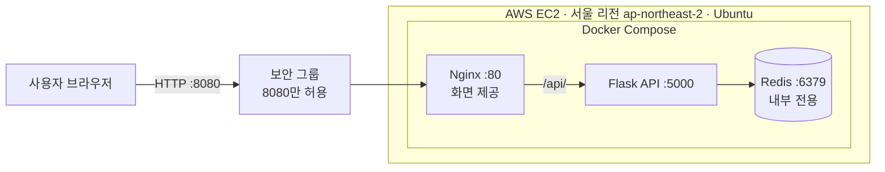

# TICKET·ON 좌석 티켓 예매 서비스

경기·공연 예매가 열리는 순간 접속이 몰려도 **같은 좌석이 중복 예매되지 않도록**, 좌석을 일정 시간 임시 확보한 뒤 결제로 확정하는 티켓 예매 웹서비스입니다.

- 배포 주소: http://<퍼블릭IP>:8080 
- 저장소: https://github.com/Aa26178787/ticket_booking
- 작업 버전: <커밋 해시>

## 1. 서비스 소개

### 대상 사용자
인기 경기·공연의 좌석을 예매하려는 사용자

### 해결하려는 문제
예매 오픈 직후 여러 사용자가 동시에 같은 좌석을 누르면, 서버가 이를 제대로 처리하지 못할 경우 한 좌석이 두 명에게 팔리는 중복 예매가 생깁니다. 이 서비스는 좌석 선택을 Redis의 원자적 연산(`SET NX EX`)으로 처리해, 동시에 눌러도 **한 명만 좌석을 확보**하고 나머지는 "이미 선택된 좌석" 응답을 받도록 했습니다. 확보한 좌석은 제한 시간(기본 5분)이 지나면 자동으로 풀려 다른 사용자가 예매할 수 있습니다.

### 핵심 기능

| # | 기능 | 사용자 입력 | 결과 |
|---|---|---|---|
| 1 | 경기 선택·좌석 조회 | 경기 카드에서 "예매하기" | 등급별 좌석 배치도(40석)와 실시간 상태 표시 |
| 2 | 좌석 다중 선택(임시 확보) | 닉네임 입력 후 좌석 클릭 (최대 4매) | 선택 좌석이 5분간 내 좌석으로 잠기고 남은 시간·금액 표시 |
| 3 | 결제(예매 확정) | "N매 결제하기" | 예매번호 발급, 모든 사용자 화면에 예매 완료로 표시 |
| 4 | 예매 내역 조회 | "예매확인/취소" 메뉴 | 닉네임의 예매 티켓 목록 표시 |
| 5 | 예매 취소 | 티켓의 "예매 취소" | 내역에서 삭제, 좌석이 다시 예매 가능 상태로 전환 |

좌석 등급: A·B행 VIP석 50,000원 / C·D행 R석 35,000원 / E행 일반석 20,000원

### 화면 구성
- 메인: 예매 중인 경기 카드 목록
- 예매: 진행 단계(좌석 선택 → 결제 → 예매 완료), 좌석 배치도, 선택 좌석 패널(남은 시간, 총 결제 금액)
- 예매확인/취소: 티켓 형태의 예매 내역과 취소 버튼

### 기술 구성

| 구성 요소 | 역할 |
|---|---|
| Nginx | 화면(HTML/CSS/글꼴) 제공, `/api/` 요청을 Flask로 전달 |
| Flask | 좌석 조회·확보·결제·내역·취소 API |
| Redis | 좌석 확보(TTL), 예매 기록 저장 |
| Docker Compose | 세 컨테이너를 한 번에 실행 |

### API

| 메서드 | 경로 | 설명 |
|---|---|---|
| GET | `/api/health` | 상태 확인 |
| GET | `/api/events` | 경기 목록 |
| GET | `/api/events/<id>/seats?nickname=` | 좌석 상태 조회 (내 선택 좌석 구분) |
| POST | `/api/events/<id>/seats/<seat>/hold` | 좌석 임시 확보 |
| DELETE | `/api/events/<id>/seats/<seat>/hold` | 임시 확보 해제 |
| POST | `/api/events/<id>/confirm` | 선택 좌석 일괄 결제(예매 확정) |
| GET | `/api/bookings?nickname=` | 예매 내역 조회 |
| DELETE | `/api/events/<id>/seats/<seat>/booking` | 예매 취소 |

## 2. AWS 구성도



### 사용자 요청 경로
브라우저 → EC2 퍼블릭 IP:8080 → (보안 그룹) → Nginx 컨테이너 → 정적 화면 응답 또는 `/api/` 요청을 Flask로 전달 → Flask가 Redis에서 좌석 상태를 읽고 써서 응답

### 사용한 AWS 서비스와 선택 이유

| 서비스 | 역할 | 선택 이유 |
|---|---|---|
| EC2 | Docker Compose 앱을 실행하는 가상 서버 | 로컬에서 검증한 Compose 구성을 그대로 올릴 수 있어 배포 과정의 변수가 가장 적음 |
| 보안 그룹 | 인바운드 접근 제어 | 웹 포트 8080만 외부에 열고 Flask(5000)·Redis(6379)는 외부에 노출하지 않음 |

- 리전: 서울(ap-northeast-2). 사용자와 가까워 지연 시간이 적음
- 인스턴스: <인스턴스 유형>

## 3. 실행·배포 방법

### 준비 사항
- Git
- Docker, Docker Compose
- (배포 시) AWS 계정, EC2 인스턴스

### 로컬 실행

```bash
git clone https://github.com/Aa26178787/ticket_booking.git
cd ticket_booking
docker compose up -d --build
```

- 접속 주소: http://localhost:8080
- 상태 확인: http://localhost:8080/api/health

### AWS(EC2) 배포 절차

1. 서울 리전에서 Ubuntu EC2를 준비하고, 보안 그룹 인바운드 규칙에 **TCP 8080, 소스 0.0.0.0/0**을 추가합니다.
2. EC2 Instance Connect로 접속해 Docker를 설치하고 사용자를 docker 그룹에 추가합니다.

   ```bash
   sudo apt-get update
   sudo apt-get install -y docker.io docker-compose-v2 git
   sudo usermod -aG docker $USER   
   ```

3. 저장소를 받아 실행합니다.

   ```bash
   git clone https://github.com/Aa26178787/ticket_booking.git
   cd ticket_booking
   docker compose up -d --build
   docker compose ps   
   ```

4. 브라우저에서 http://<퍼블릭IP>:8080 으로 접속합니다.

### 포트

| 포트 | 대상 | 외부 개방 |
|---|---|---|
| 8080 → 80 | Nginx | 개방 (서비스 접속 주소) |
| 5000 | Flask | 비공개 (Compose 내부) |
| 6379 | Redis | 비공개 (Compose 내부) |

### 설정 (환경변수)

| 이름 | 기본값 | 설명 |
|---|---|---|
| HOLD_SECONDS | 300 | 좌석 임시 확보 시간(초). 만료 시험 시 `HOLD_SECONDS=10 docker compose up -d` |
| MAX_SEATS | 4 | 1인당 한 번에 선택할 수 있는 좌석 수 |

### 코드 수정 반영과 데이터 초기화

```bash
git pull
docker compose up -d --build
docker compose exec redis redis-cli FLUSHALL   # 예매 데이터 초기화(필요 시)
```

## 4. 검증 (AWS 배포 주소에서 시험)

시험 환경: AWS EC2(서울), http://<퍼블릭IP>:8080, 브라우저 2개(일반 창 / 시크릿 창)

| 기능 | 구분 | 입력 | 기대 결과 | 실제 결과 |
|---|---|---|---|---|
| 1 좌석 조회 | 정상 | 경기 카드에서 "예매하기" | 좌석 40석과 상태 표시 | <기록> |
| 1 좌석 조회 | 실패 | 없는 경기 요청 `/api/events/99/seats` | 404 "경기를 찾을 수 없습니다" | <기록> |
| 2 좌석 선택 | 정상 | 창 A에서 좌석 3개 선택 | 내 선택(빨강) 표시, 창 B에서는 선택 중(주황) | <기록> |
| 2 좌석 선택 | 경계 | 창 B에서 창 A가 선택한 좌석 선택 / 5번째 좌석 선택 | 409 "이미 선택된 좌석입니다" / 400 "최대 4매" | <기록> |
| 3 결제 | 정상 | 확보 시간 내 "결제하기" | 예매번호 발급, 모든 화면에 예매 완료(회색) | <기록> |
| 3 결제 | 경계 | 확보 시간 만료 후 결제 (`HOLD_SECONDS=10`) | 410 "확보 시간이 만료되었습니다" | <기록> |
| 4 내역 조회 | 정상 | 예매한 닉네임으로 조회 | 예매번호가 있는 티켓 표시 | <기록> |
| 4 내역 조회 | 실패 | 닉네임 없이 조회 | "닉네임을 입력해 주세요" 안내 | <기록> |
| 5 예매 취소 | 정상 | 본인 티켓 "예매 취소" | 내역에서 삭제, 좌석이 다시 예매 가능 | <기록> |
| 5 예매 취소 | 실패 | 다른 닉네임으로 취소 요청 | 403 "본인의 예매만 취소할 수 있습니다" | <기록> |

## 5. 확장 검토 (ELB · Auto Scaling)

- **적용 여부: 적용하지 않음** (단일 EC2 구성)
- **판단 근거**
  - 과제 시연 규모(동시 접속 수 명)는 EC2 한 대로 충분히 처리됩니다.
  - ALB는 시간당 요금이 별도로 발생하고, Auto Scaling으로 서버가 늘어나면 비용도 함께 늘어나 이번 규모에서는 비용 대비 효과가 작다고 판단했습니다.
- **확장이 필요한 경우의 구조**
  - 좌석 상태를 서버 메모리가 아니라 Redis에 저장하므로, API 서버를 여러 대로 늘려도 모든 서버가 같은 좌석 상태를 공유합니다.
  - 예매 오픈처럼 접속이 몰리는 시점에는 ALB로 요청을 분산하고, EC2 Auto Scaling 그룹(예: 최소 1 / 희망 2 / 최대 3)으로 CPU 사용률 기준 서버 수를 조절할 수 있습니다.
  - 이때 Redis는 각 서버 안이 아닌 공용 저장소(예: Amazon ElastiCache)로 분리해야 합니다.
- **비용 관리**: 최대 서버 수 제한, 예산 알림 설정, 사용 후 ALB·서버 삭제

## 6. 한계와 개선 방향
- 로그인 없이 닉네임으로 사용자를 구분하므로, 닉네임을 알면 다른 사람의 예매를 조회·취소할 수 있습니다. 실제 서비스에서는 로그인 또는 예매 비밀번호가 필요합니다.
- 결제는 실제 결제 연동 없이 버튼으로 대체했습니다.

## 7. 기록

### AI 사용
- 사용 여부: O
- 사용 도구: Claude
- 활용 범위: UI 작업 및 app.py 구조 작성
- 직접 수행·확인한 결과: EC2 배포와 보안 그룹 설정, 프로젝트 구성 

